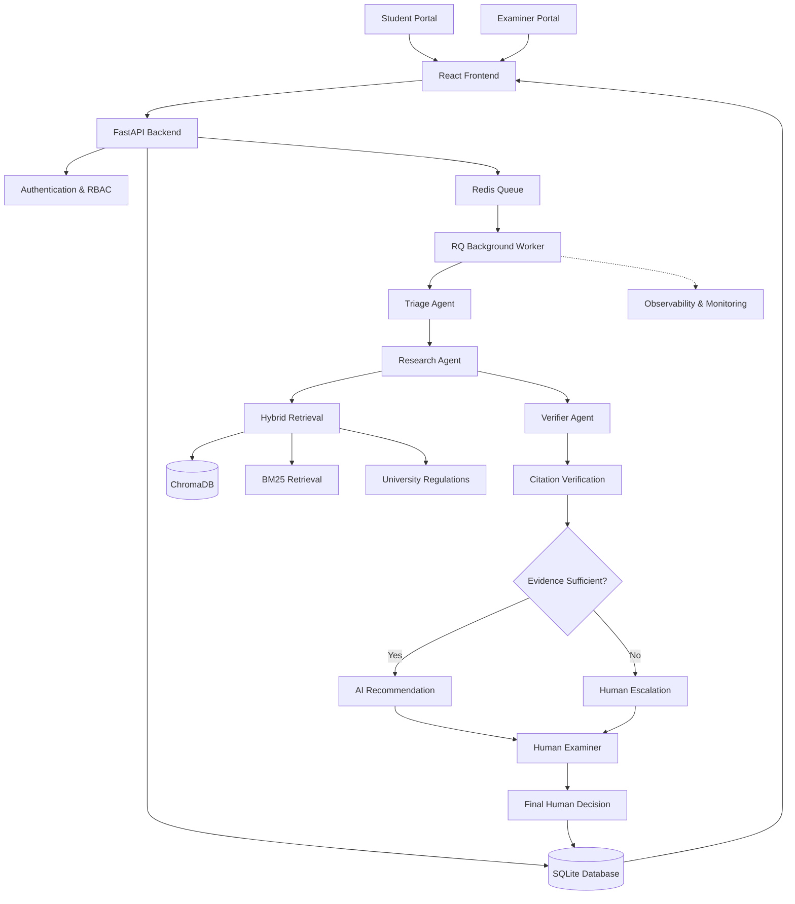

<div align="center">

# 🎓 Academic Petition Triage System

### AI-Powered Academic Regulation Analysis & Student Petition Management

**Turning complex academic petitions into evidence-backed recommendations through multi-agent AI, regulatory retrieval and human-supervised decision-making.**

<br/>

[](https://www.python.org/)
[](https://react.dev/)
[](https://www.typescriptlang.org/)
[](https://fastapi.tiangolo.com/)
[](https://www.langchain.com/langgraph)
[](https://www.docker.com/)

<br/>

**Student Portal · Examiner Portal · Multi-Agent RAG · Citation Verification · Human-in-the-Loop**

<br/>

[🚀 Quick Start](#-quick-start) · [✨ Features](#-key-features) · [🏗️ Architecture](#️-system-architecture) · [🧪 Testing](#-testing) · [📖 Documentation](#-documentation)

</div>

---

## 📌 Overview

Academic institutions receive petitions involving attendance shortages, medical emergencies and exceptional academic circumstances. Reviewing these requests requires examining student submissions, supporting evidence and applicable university regulations.

The **Academic Petition Triage System** is an AI-assisted platform designed to streamline this process.

Students submit synthetic academic petitions through a dedicated portal. A coordinated team of three AI agents investigates each petition, retrieves relevant regulatory clauses, verifies citations against source documents and prepares an evidence-backed recommendation.

Cases involving uncertainty, insufficient evidence or unresolved regulatory interpretation are escalated to a human examiner.

> **Core principle: AI recommends. Humans decide.**
>
> The system never makes the final academic decision. Every binding determination is recorded separately by an authorised human examiner.

---

## ✨ Key Features

<table>
<tr>
<td width="50%">

### 🎓 Student Portal

- Dedicated student authentication.
- Personal academic dashboard.
- Structured petition submission.
- Supporting document uploads.
- Petition history and tracking.
- AI recommendation visibility.
- Regulatory evidence inspection.
- Human decision notifications.

</td>
<td width="50%">

### 🏛️ Examiner Portal

- Separate examiner authentication.
- Centralised petition review queue.
- Search and filtering.
- AI recommendation inspection.
- Verbatim regulatory citations.
- Supporting evidence downloads.
- Request additional information.
- Accept or reject petitions.
- Attributed examiner decisions.

</td>
</tr>
<tr>
<td>

### 🤖 Multi-Agent AI Pipeline

- Triage Agent.
- Research Agent.
- Verifier Agent.
- LangGraph orchestration.
- Structured agent communication.
- Evidence-grounded recommendations.
- Safe escalation mechanisms.

</td>
<td>

### 🔎 Retrieval & Verification

- ChromaDB vector retrieval.
- BM25 keyword retrieval.
- Hybrid retrieval pipeline.
- Sentence Transformer embeddings.
- Regulatory clause extraction.
- Verbatim citation verification.
- Source and page references.

</td>
</tr>
<tr>
<td>

### ⚙️ Reliability & Processing

- Redis-backed background processing.
- RQ workers.
- Retry mechanisms.
- Circuit breakers.
- Rate limiting.
- Response caching.
- Failure handling.
- Safe escalation on system failures.

</td>
<td>

### 📊 Monitoring & Evaluation

- Prometheus metrics.
- Grafana dashboards.
- OpenTelemetry tracing.
- Jaeger integration.
- Locust load testing.
- Automated evaluation scenarios.
- Security checks.
- System health monitoring.

</td>
</tr>
</table>

---

## 🏗️ System Architecture

The application follows a modular architecture with separate frontend, backend, AI orchestration, retrieval, persistence and observability components.



### The Three-Agent Workflow

| Agent | Responsibility |
|---|---|
| **1. Triage Agent** | Validates petition information, identifies the petition category and determines whether investigation can proceed. |
| **2. Research Agent** | Retrieves relevant regulatory passages using semantic and keyword-based retrieval. |
| **3. Verifier Agent** | Checks whether the retrieved citations and supporting evidence substantiate the proposed recommendation. |

### Decision Lifecycle

```text
Student Submission
       │
       ▼
Input Validation & Guardrails
       │
       ▼
   Triage Agent
       │
       ▼
  Research Agent
       │
       ▼
  Verifier Agent
       │
       ▼
Evidence & Citation Verification
       │
       ├───────────────┐
       ▼               ▼
Recommendation     Escalation
       │               │
       └───────┬───────┘
               ▼
       Human Examiner
               │
               ▼
      Official Decision
               │
               ▼
       Student Portal
```

---

## 🧰 Technology Stack

| Layer | Technologies |
|---|---|
| Frontend | React, Vite, TypeScript, Tailwind CSS |
| UI Components | shadcn/ui-style components, Lucide Icons |
| Backend | Python, FastAPI |
| Agent Orchestration | LangGraph |
| LLM Integration | OpenAI-compatible Chat API |
| Retrieval Framework | LangChain |
| Vector Database | ChromaDB |
| Keyword Retrieval | BM25 |
| Embeddings | Sentence Transformers |
| Background Processing | Redis, RQ |
| Database | SQLite |
| Containerisation | Docker, Docker Compose |
| Testing | pytest, Vitest, Testing Library |
| Browser Testing | Existing E2E test tooling |
| Load Testing | Locust |
| Metrics | Prometheus, Grafana |
| Distributed Tracing | OpenTelemetry, Jaeger |

---

## 🔐 Authentication & Role-Based Access Control

The application provides separate authenticated experiences for students and examination board officers.

### Student Authentication

- Student ID and password authentication.
- Bcrypt password hashing.
- Session-based access.
- Student-specific petition visibility.
- Restricted access to personal academic records.

### Examiner Authentication

- Separate examiner login.
- Role-based authorisation.
- Protected review endpoints.
- Examiner-attributed decisions.
- Separate persistence of human decisions.

### Security Implementation

- Salted bcrypt password hashing.
- Opaque session tokens.
- Session expiration and revocation.
- Backend role enforcement.
- Login rate limiting.
- Student record isolation.
- Upload and download validation.

**Note:** Demonstration credentials are intended for local evaluation only. Automatic demo-account seeding is disabled in production mode.

---

## 🧪 Demonstration Environment

The project includes synthetic demonstration accounts and pre-seeded academic cases.

All student identities and records below are fictional.

### 🎓 Student Accounts

**Default demonstration password:** `Student@123`

| Student ID | Student Name | Department | Semester | Demonstration Case |
|---|---|---|---|---|
| `STU2026001` | Alex Mercer | CSE | 6 (A) | 80% attendance, hospitalisation |
| `STU2026002` | Priya Sharma | ISE | 4 (B) | 77.8% attendance, sports duty leave |
| `STU2026003` | Marcus Chen | ECE | 2 (C) | 81.25% attendance, bereavement |

### 🏛️ Examiner Accounts

**Default demonstration password:** `Examiner@123`

| Examiner ID | Name | Role |
|---|---|---|
| `EXM2026001` | Dr. Eleanor Vance | Examination Board Chairperson |
| `EXM2026002` | Prof. Rajesh Kulkarni | Member Secretary |

### Application Access

| Portal | URL |
|---|---|
| Central Gateway | http://localhost:8080/ |
| Student Login | http://localhost:8080/student/login |
| Student Profile | http://localhost:8080/student/profile |
| Examiner Login | http://localhost:8080/examiner/login |
| Examiner Review Queue | http://localhost:8080/examiner/queue |
| FastAPI Documentation | http://localhost:8000/docs |

---

## 🚀 Quick Start

### Prerequisites

Install the following:

- Docker Desktop.
- Git.
- A supported LLM API key (optional for fallback demonstration).
- Node.js and Python for local development.

### 1. Clone the Repository

```bash
git clone https://github.com/raviteja2028tech/Academic-petition-triage-system.git

cd Academic-petition-triage-system
```

### 2. Configure Environment Variables

```bash
cp .env.example .env
```

Open `.env` and configure your LLM provider:

```env
LLM_BASE_URL=your_openai_compatible_endpoint
LLM_API_KEY=your_api_key
LLM_MODEL=your_supported_model
```

Never commit your `.env` file or expose API credentials.

If the LLM configuration is left blank, the system safely escalates petitions with the reason `llm_unavailable`. It does not generate fabricated AI recommendations.

### 3. Build and Start the Application

```bash
docker compose up -d --build
```

The initial build may take longer because it downloads dependencies, model files and container images.

### 4. Check Container Status

```bash
docker compose ps
```

Verify the required services are running and healthy.

### 5. Access the Application

Open:

**http://localhost:8080**

The React application provides the Student Portal, Examiner Portal and system interfaces.

---

## ⚙️ Additional Commands

### View Application Logs

```bash
docker compose logs -f api
```

Worker logs:

```bash
docker compose logs -f worker
```

### Restart Services

```bash
docker compose restart
```

### Rebuild the Application

```bash
docker compose up -d --build
```

### Scale Background Workers

```bash
docker compose up -d --scale worker=3
```

### Re-index the Regulatory Corpus

```bash
docker compose run --rm ingest
```

### Enable Observability

```bash
docker compose --profile observability up -d
```

Observability interfaces:

| Service | URL |
|---|---|
| Jaeger | http://localhost:16686 |
| Prometheus | http://localhost:9090 |
| Grafana | http://localhost:3000 |
| cAdvisor | http://localhost:8081 |

### Stop the Application

```bash
docker compose down
```

To remove containers, volumes, database, indexes and cached data:

```bash
docker compose down -v
```

**Warning:** The second command deletes persisted application data.

---

## 🧠 LLM Integration & Fallback Behaviour

The system supports OpenAI-compatible chat APIs.

The configured provider and model are controlled through environment variables.

### Real LLM Mode

When valid provider credentials and a supported model are configured, the agents execute the real LLM workflow.

The project has documented real-model end-to-end execution using:

- Groq-hosted `openai/gpt-oss-120b`
- `qwen/qwen3.8-27b`

The difficult 80% attendance medical-certificate scenario was tested with real models and escalated to a human examiner with two verified regulatory citations.

### Stub / Scripted Mode

A scripted model is available for controlled demonstrations and load testing.

```bash
docker compose --profile loadtest up -d --build llm-stub
```

Configure the API and worker to use the stub provider according to the environment configuration:

```env
LLM_BASE_URL=http://llm-stub:9100/v1
LLM_MODEL=stub-model
LLM_API_KEY=
```

The application must clearly identify scripted-model output.

> **Important:** Stub mode demonstrates the workflow and retrieval machinery, not genuine LLM reasoning.

### Rate Limits

A complete real-model investigation can consume approximately 13,000–23,000 tokens.

Processing time depends on provider availability, request limits and token throughput.

When a provider quota is exhausted or a service fails, the system escalates instead of inventing a result.

---

## 📊 Evaluation & Testing

The project includes automated testing, evaluation scenarios, reliability checks and load-testing utilities.

### Backend Testing

```bash
pip install -r requirements-dev.txt

python -m pytest -q
```

### Frontend Testing

```bash
cd frontend

npm ci

npm test

npm run build
```

### Security Scan

```bash
python scripts/check_no_secrets.py
```

### Security Probe

```bash
python scripts/security_probe.py
```

### Load Testing

```bash
python loadtest/benchmark.py --suite quick
```

Run the complete benchmark suite:

```bash
python loadtest/benchmark.py --suite all
```

### Failure Drills

```bash
python loadtest/failure_drills.py
```

### Scripted Evaluation

```bash
PYTHONPATH=src python -m triage.evaluation.run --mode scripted --retriever hash
```

### Real-Model Evaluation

Run inside Docker so that Redis and ChromaDB are accessible:

```bash
docker compose run --rm worker python -m triage.evaluation.run --mode real --retriever env --pause 60 --resume --out /app/eval/results/real.json
```

Regenerate the evaluation report:

```bash
python scripts/make_eval_report.py
```

Refer to `TESTING_REPORT.md` and `PROJECT_STATUS.md` for the recorded test evidence and actual results.

---

## 📁 Repository Structure

```text
Academic-petition-triage-system/
│
├── frontend/                 # React + Vite + TypeScript frontend
│
├── src/
│   └── triage/
│       ├── api/              # FastAPI application and routes
│       ├── agents/           # LangGraph agents and tools
│       ├── llm/              # LLM provider integration
│       ├── retrieval/        # ChromaDB, BM25 and hybrid retrieval
│       ├── reliability/      # Retry, caching and circuit breakers
│       ├── guardrails/       # Input and output safety
│       ├── evaluation/       # Evaluation framework
│       ├── observability/    # Metrics and tracing
│       ├── worker/           # RQ background tasks
│       ├── auth.py           # Authentication
│       ├── db.py             # Database management
│       └── config.py         # Environment configuration
│
├── corpus/                   # Regulatory corpus metadata and sources
├── prompts/                  # Versioned agent prompts
├── eval/                     # Synthetic evaluation scenarios
├── loadtest/                 # Locust and benchmark utilities
├── e2e/                      # Browser end-to-end tests
├── tests/                    # Automated Python tests
├── scripts/                  # Security and evaluation utilities
├── docs/                     # Detailed technical documentation
├── docker/                   # Dockerfiles
├── ui/                       # Streamlit fallback interface
│
├── docker-compose.yml
├── .env.example
├── .gitignore
├── ARCHITECTURE.md
├── SPEC.md
├── PROJECT_STATUS.md
├── TESTING_REPORT.md
├── SYSTEM_TESTING_REPORT.md
├── LOAD_TEST_REPORT.md
├── SECURITY_REVIEW.md
├── DEMO_GUIDE.md
├── KNOWN_LIMITATIONS.md
└── README.md
```

---

## 🛡️ Safety, Governance & Limitations

The system is designed as an academic decision-support tool, not an autonomous decision-maker.

### Safety Principles

- Student submissions and retrieved passages are treated as untrusted input.
- Prompt injection and abusive input are handled through guardrails.
- Agents use validated retrieval tools.
- Citations are accepted only when the quoted text matches the indexed source passage.
- Regulatory page and clause references are taken from indexed metadata.
- Unverified interpretations are not presented as established university policy.
- Insufficient evidence results in human escalation.
- Provider, retrieval and processing failures do not produce fabricated decisions.
- Human decisions are stored separately from AI recommendations.

### Known Limitations

1. Only attendance petitions currently receive automated AI analysis. Other petition categories are escalated.
2. The examination bye-laws are not fully represented in the verified corpus.
3. The interpretation of the regulatory `10%` provision requires institutional confirmation.
4. The identity of the final deciding authority requires institutional confirmation.
5. Real-model outputs depend on external provider availability and rate limits.
6. The system is designed for synthetic demonstration data, not unrestricted deployment with real student records.

See [`KNOWN_LIMITATIONS.md`](KNOWN_LIMITATIONS.md) for the detailed limitations.

---

## 📚 Documentation

| Document | Description |
|---|---|
| [SPEC.md](SPEC.md) | Project specification and requirements |
| [ARCHITECTURE.md](ARCHITECTURE.md) | System architecture |
| [PROJECT_STATUS.md](PROJECT_STATUS.md) | Implementation status and evidence |
| [TESTING_REPORT.md](TESTING_REPORT.md) | Backend and frontend test results |
| [SYSTEM_TESTING_REPORT.md](SYSTEM_TESTING_REPORT.md) | End-to-end system testing |
| [LOAD_TEST_REPORT.md](LOAD_TEST_REPORT.md) | Performance and load testing |
| [SECURITY_REVIEW.md](SECURITY_REVIEW.md) | Security review |
| [DEMO_GUIDE.md](DEMO_GUIDE.md) | Demonstration instructions |
| [KNOWN_LIMITATIONS.md](KNOWN_LIMITATIONS.md) | Known gaps and limitations |
| [docs/EVALUATION_REPORT.md](docs/EVALUATION_REPORT.md) | Evaluation results |

---

## 🎯 Academic Context

**Project:** Mini Project 15 — Academic Regulation and Student Petition Triage

**Course:** ML System Design & AgentOps

**Course Code:** UE24AM342AA5

**Institution:** PES University, Bengaluru

**Specialisation:** Computer Science and Engineering — Artificial Intelligence & Machine Learning

The project explores the application of multi-agent AI, retrieval-augmented generation, regulatory evidence verification, asynchronous processing, observability and human-in-the-loop decision-making in an academic administrative workflow.

---

## 👨‍💻 Author

**Raviteja**

Computer Science & Engineering — Artificial Intelligence & Machine Learning  
PES University, Bengaluru

---

<div align="center">

### Built to make academic petition review more transparent, evidence-based and accountable.

**AI assists the process. Human judgment remains final.**

<br/>

⭐ If you find this project interesting, consider giving the repository a star.

</div>
